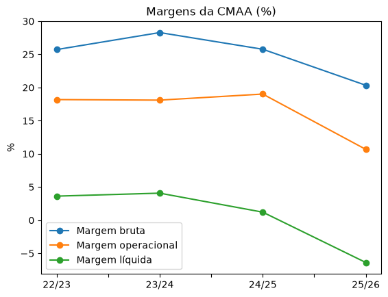
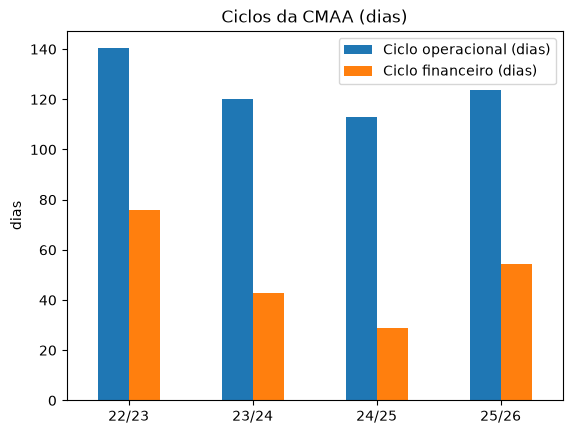

# Análise financeira da CMAA

Projeto em Python que calcula margens, crescimento, capital de giro e endividamento da CMAA (Companhia Mineira de Açúcar e Álcool Participações) nos anos-safra 22/23 a 25/26.

## Fonte dos dados

Demonstrações financeiras divulgadas pela empresa na [Central de Resultados](https://www.cmaa.ind.br/investidores/central-de-resultados), organizadas em planilha pelo grupo e convertidas em `dre.csv` e `bp.csv`.

## Observações

- Valores em R$ mil. Períodos em anos-safra.
- O lucro bruto já inclui a variação do valor justo.
- O EBITDA é o EBIT mais a depreciação.
- A NCG soma clientes, ativo biológico, estoques e impostos a recuperar, e subtrai fornecedores e adiantamentos de clientes. Os prazos médios e os ciclos usam base de 360 dias.
- A dívida bruta soma empréstimos e financiamentos e arrendamentos e parcerias agrícolas a pagar, no circulante e no não circulante.

## Conclusões

- A margem líquida cai de 3,6% (22/23) para -6,4% (25/26).
- A receita líquida cai 11,9% em 25/26.
- O resultado financeiro passa de -R$ 327 milhões para -R$ 500 milhões.
- A dívida líquida sobre o EBITDA sobe de 2,3x para 3,5x.
- O ciclo financeiro cai de 75,9 para 29,0 dias até 24/25 e volta a 54,4 dias em 25/26.

## Gráficos

## Como executar

1. Instale as bibliotecas: `pip install -r requirements.txt`
2. Abra `analise.ipynb` e execute as células em ordem.
3. Os resultados são salvos em `resultado_cmaa.xlsx`.

## Tecnologias

Python, pandas e matplotlib.

## Observação final

Projeto de estudo, sem recomendação de investimento.

## Autor

Pedro Rocha Souza | [LinkedIn](https://www.linkedin.com/in/pedro-rsouza/) | [GitHub](https://github.com/Peuzz1)